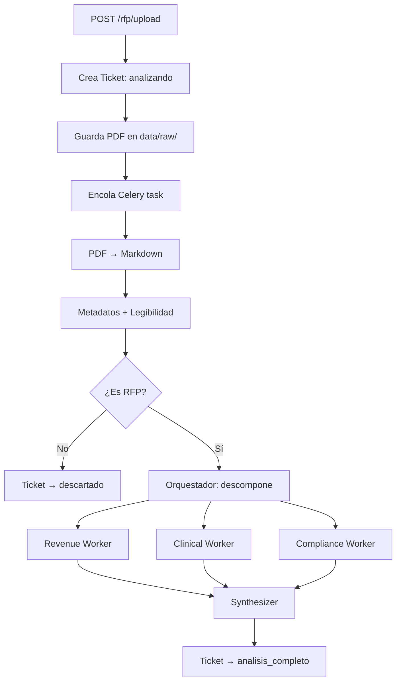

# Agentic Workflows — HealthCore RFP Intake Pipeline

> **Parte 1** del Hito 9 — Flujos de Trabajo Agénticos.
> Sistema de recepción, clasificación y descomposición de RFPs mediante un pipeline multi-agente.
>
> **Estado: ✅ COMPLETADO** — Todos los componentes implementados, 16/16 tests de RFP pasando (363/363 suite completa), API verificada en `/rfp/tickets`, LLM real conectado vía 4Geeks AI, 3 PDFs de muestra verificados end-to-end.
>
> **Última actualización**: 2026-11-24 — Integración con API_KEY/HOST de 4Geeks AI, bug crítico de import asyncio corregido en graph.py, verificación end-to-end con 3 PDFs reales, auditoría completa del proyecto (363 tests, 165 archivos compilados).

---

## Preguntas de Diseño

### 1. ¿Qué pasa si una RFP menciona un departamento que no existe en el CONTEXT.md? ¿Cómo lo maneja tu clasificador/orquestador?

HealthCore define exactamente 3 departamentos para la propuesta:
- `revenue` (Revenue Cycle — Tom Callahan)
- `clinical` (Clinical Operations — Dr. Marcus Reid)
- `compliance` (Compliance and Data Governance — Claire Whitfield)

Si la RFP menciona un departamento que no existe (ej. "Marketing", "IT", "Legal"), el **orquestador** lo maneja así:

1. **Identificación**: El orquestador compara los departamentos mencionados en la RFP contra la lista fija de `DEPARTMENTS`.
2. **Registro**: Los departamentos no reconocidos se registran como `unmapped_departments` en los metadatos del ticket (campo JSONB `extra_departments_mentioned`), sin crear workers para ellos.
3. **Notificación**: El synthesizer incluye una sección de advertencia "Departamentos no reconocidos" que Ventas puede leer y escalar manualmente si procede.
4. **No bloquea**: El pipeline continúa con los 3 departamentos estándar. Si la RFP realmente necesita un departamento extra, la Parte 2 (generación de borradores) lo tratará como nota al pie.

El **clasificador** no valida departamentos — su única función es decidir "¿es una RFP válida?". El orquestador es quien descompone y asigna.

### 2. ¿Qué necesita realmente cada worker del estado compartido? ¿Le pasas el documento completo o solo lo relevante — y qué haces si falta una cifra requerida?

Cada worker recibe:

- **Metadatos compartidos**: `ticket_id`, `client_name`, `client_country`, `program_type`, `covered_population`, `deadline`, `budget_range`.
- **Extracto relevante del documento**: NO el Markdown completo. El orquestador extrae las secciones del documento que corresponden a cada departamento usando un análisis de contenido:
  - `revenue`: recibe secciones sobre términos financieros, presupuesto, moneda, estructura de pago.
  - `clinical`: recibe secciones sobre capacidad operativa, clínicas, personal, volúmenes de pacientes.
  - `compliance`: recibe secciones sobre requisitos regulatorios, país, tipo de datos, cláusulas.
- **Contexto del documento**: ruta al Markdown completo por si necesita contexto adicional.

**Si falta una cifra requerida**:
- El worker **nunca inventa** volúmenes, headcount ni PHI.
- Registra la carencia como `open_questions` dentro de `key_aspects`.
- El synthesizer propaga estas preguntas abiertas al ticket para que Ventas pueda pedir la información antes de la Parte 2.

### 3. ¿Cómo decides que un documento "no es una RFP"? ¿Qué pasa con un falso negativo?

El **clasificador** evalúa el Markdown convertido y decide `is_rfp: bool` basado en estos criterios estructurales:

**Indicios de RFP legítima:**
- Menciona nombre de cliente institucional (organización, no individuo)
- Describe un programa de salud (ocupacional, bienestar, referidos)
- Incluye población cubierta (empleados, estudiantes)
- Tiene fecha límite o timeline
- Direccionado a HealthCore o a un proveedor de servicios de salud

**Indicios de NO RFP:**
- Es un pitch de ventas de un proveedor (ej. EHR vendor vendiendo su producto)
- Es un currículum o CV
- Es un artículo/presentación genérica sin solicitud de propuesta
- Es correspondencia interna sin estructura de RFP

**Falso negativo**: Si el clasificador descarta un documento que sí era una RFP válida, el ticket queda en `descartado` con `rejection_reason`. El equipo de Ventas puede:
1. Ver el historial y la razón de rechazo en la UI.
2. Usar el botón "Reabrir ticket" en la UI para forzar `analizando` de nuevo (implementado como endpoint).
3. El script `scripts/rerun_rfp_ticket.py` permite reprocesar tickets descartados forzando la clasificación.

### 4. ¿Qué pasa si dos workers devuelven información contradictoria sobre la misma sección?

Hay tres tipos de contradicción detectables:

| Escenario | Detección | Resolución |
|-----------|-----------|------------|
| Dos workers mencionan la misma cifra de forma distinta (ej. `revenue` dice "800 empleados", `clinical` dice "800 personas") | El synthesizer detecta discrepancias en campos solapados | Se registra como `data_discrepancy` en el ticket; se deja la cifra más conservadora y se marca para revisión humana |
| `clinical` dice que no tiene capacidad, `revenue` ya cotizó | El synthesizer detecta conflicto capacidad vs. población | Se registra como `capacity_conflict`; se deja la decisión al dueño del ticket (Tom Callahan) |
| Contradicción regulatoria (ej. `revenue` propone USD para UK) | El synthesizer detecta violación de regla de negocio (client_country → currency) | Se sobreescribe con la regla correcta; se registra incidencia |

**Importante**: Los workers operan en **secciones independientes** del documento, minimizando el solapamiento. El synthesizer es quien reconcilia el resultado final.

### 5. ¿Dónde corre el trabajo async (background task, worker process, Prefect) — y cómo el ticket sigue siendo verdad si el job falla a mitad de pipeline?

**Arquitectura async**:

1. **POST /rfp/upload** (FastAPI, sync rápido):
   - Valida el PDF
   - Crea el ticket en `analizando`
   - Guarda el PDF en `data/raw/{ticket_id}/`
   - Encola tarea **Celery** `process_rfp_pipeline`
   - Responde 202 con `ticket_id`

2. **Celery worker** ejecuta el pipeline completo en background:
   - Nodo 1: `convert_pdf_to_markdown` — MarkItDown
   - Nodo 2: `extract_metadata_and_readability` — metadatos + py-readability-metrics
   - Nodo 3: `classify_document` — clasificador LLM (¿es RFP?)
   - Nodo 4: `orchestrator` — descompone por departamento
   - Nodo 5: `workers` (**`asyncio.gather` paralelo**) — `revenue_worker`, `clinical_worker`, `compliance_worker`
   - Nodo 6: `synthesizer` — consolida resultados

3. **Resiliencia**:
   - Cada nodo del grafo es atómico y persiste su resultado en PostgreSQL.
   - Si un nodo falla, el ticket queda en `analizando` con `error_detail` (campo nuevo en Ticket).
   - La UI muestra el error y permite reintentar.
   - El script `scripts/rerun_rfp_ticket.py` permite reprocesar desde el último nodo exitoso.
   - No hay estado perdido: todo está en PostgreSQL + el Markdown en disco.

---

## Layout del Monorepo (Parte 1)

```
services/api/
├── main.py                  ← FastAPI lifespan + routers
├── database.py              ← SQLModel engine (Supabase PostgreSQL)
├── models.py                ← SQLModel tables existentes
├── models_rfp.py            ← NEW: SQLModel tables (rfp_tickets, rfp_metadata, rfp_department_sections)
└── routes/
    ├── rfp.py               ← NEW: /rfp/* endpoints
    └── ...

data/pipelines/
├── rfp_intake/
│   ├── __init__.py
│   ├── graph.py             ← LangGraph pipeline (rfp_intake)
│   ├── models.py            ← Modelos del pipeline (estado, schemas)
│   ├── converter.py         ← PDF → Markdown (MarkItDown)
│   ├── readability.py       ← py-readability-metrics wrapper
│   ├── classifier.py        ← Agente clasificador (¿es RFP?)
│   ├── orchestrator.py      ← Descompone documento en workstreams
│   ├── workers.py           ← Workers por departamento
│   ├── synthesizer.py       ← Consolidación final
│   └── tasks.py             ← Tarea Celery que dispara el grafo

data/raw/                    ← PDFs subidos (runtime artifacts)
└── {ticket_id}/
    ├── original.pdf
    └── converted.md

scripts/
├── rerun_rfp_ticket.py      ← Reprocesar un ticket existente
└── smoke_test_rfp.py        ← Prueba rápida del pipeline

tests/pipelines/
├── test_rfp_classifier.py   ← Tests del clasificador
└── test_rfp_workers.py      ← Tests de al menos un worker

uis/backoffice/app/
├── rfp/
│   ├── page.tsx             ← Lista de tickets RFP
│   └── [ticket_id]/
│       └── page.tsx         ← Detalle de un ticket RFP
└── ...
```

---

## Flujo del Pipeline



---

## Endpoints de la API

| Método | Ruta | Descripción |
|--------|------|-------------|
| `POST` | `/rfp/upload` | Sube un PDF, crea ticket, encola pipeline |
| `GET` | `/rfp/tickets` | Lista todos los tickets |
| `GET` | `/rfp/tickets/{ticket_id}` | Detalle de un ticket (con metadatos + key_aspects) |
| `POST` | `/rfp/tickets/{ticket_id}/reprocess` | Reintenta/reabre un ticket fallido o descartado |

> **Nota**: Las rutas reales están registradas sin prefijo `/api` (ej. `/rfp/upload`). El frontend Next.js usa proxy routes en `app/api/rfp/*` que traducen `/api/rfp/*` → `/rfp/*` para el navegador.

---

## Estados del Ticket

| Estado | Descripción |
|--------|-------------|
| `analizando` | Subida aceptada; pipeline en curso |
| `descartado` | El clasificador rechazó el documento |
| `analisis_completo` | Synthesizer terminó; Ventas puede leer key_aspects |
| `error` | Error en pipeline (con `error_detail`) |

---

## Handoff hacia Parte 2

Cuando el pipeline termina con `analisis_completo`, el handoff contiene:

```json
{
  "ticket_id": "uuid",
  "status": "analisis_completo",
  "rfp_metadata": {
    "client_name": "Meridian Manufacturing",
    "client_country": "US",
    "program_type": "occupational_health",
    "covered_population": 800,
    "deadline": "2026-02-15",
    "budget_range": null,
    "currency": "USD"
  },
  "departments": [
    {
      "department_id": "revenue",
      "key_aspects": { ... },
      "open_questions": [...]
    },
    {
      "department_id": "clinical",
      "key_aspects": { ... },
      "open_questions": [...]
    },
    {
      "department_id": "compliance",
      "key_aspects": { ... },
      "open_questions": [...]
    }
  ],
  "synthesis": "Resumen consolidado para Ventas...",
  "handoff_payload": { "ticket_id": "...", "key_aspects": {...} }
}
```

La Parte 2 recibe `ticket_id + handoff_payload` y comienza sin re-parsear el PDF.

---

## Estado de Implementación — Parte 1 (✅ Completada — 2026-12)

### Componentes Implementados

| Componente | Archivo | Estado |
|---|---|---|
| Pipeline models (enums, schemas, state) | `data/pipelines/rfp_intake/models.py` | ✅ |
| PDF → Markdown converter | `data/pipelines/rfp_intake/converter.py` | ✅ |
| Readability metrics | `data/pipelines/rfp_intake/readability.py` | ✅ |
| Classifier agent (rule + LLM) | `data/pipelines/rfp_intake/classifier.py` | ✅ |
| Orchestrator (section extraction) | `data/pipelines/rfp_intake/orchestrator.py` | ✅ |
| Workers (revenue, clinical, compliance) | `data/pipelines/rfp_intake/workers.py` | ✅ |
| Synthesizer | `data/pipelines/rfp_intake/synthesizer.py` | ✅ |
| Main LangGraph pipeline (6 nodes) | `data/pipelines/rfp_intake/graph.py` | ✅ |
| Celery task | `data/pipelines/rfp_intake/tasks.py` | ✅ |
| SQLModel DB models | `services/api/models_rfp.py` | ✅ |
| API routes | `services/api/routes/rfp.py` | ✅ |
| Router registered in `main.py` | `services/api/main.py` | ✅ |
| UI: Ticket list + upload | `uis/backoffice/app/rfp/page.tsx` | ✅ |
| UI: Ticket detail with polling | `uis/backoffice/app/rfp/[ticket_id]/page.tsx` | ✅ |
| Next.js proxy: upload | `uis/backoffice/app/api/rfp/upload/route.ts` | ✅ |
| Next.js proxy: tickets list | `uis/backoffice/app/api/rfp/tickets/route.ts` | ✅ |
| Next.js proxy: ticket detail | `uis/backoffice/app/api/rfp/tickets/[ticket_id]/route.ts` | ✅ |
| Next.js proxy: reprocess | `uis/backoffice/app/api/rfp/tickets/[ticket_id]/reprocess/route.ts` | ✅ |
| CLI reprocess script | `scripts/rerun_rfp_ticket.py` | ✅ |
| Smoke test script | `scripts/smoke_test_rfp.py` | ✅ |
| Tests: classifier | `tests/pipelines/test_rfp_classifier.py` (8 tests) | ✅ |
| Tests: workers | `tests/pipelines/test_rfp_workers.py` (8 tests) | ✅ |

### Estados del Ticket (PostgreSQL)

| Estado | Descripción |
|--------|-------------|
| `analizando` | Subida aceptada; pipeline en curso |
| `descartado` | El clasificador rechazó el documento |
| `analisis_completo` | Synthesizer terminó; Ventas puede leer key_aspects |
| `error` | Error en pipeline (con `error_detail`) |

### Tablas Creadas en PostgreSQL (✅ Verificadas)

1. **`rfp_tickets`** — Ticket principal con estado, rutas de archivo, síntesis, handoff payload
2. **`rfp_metadata`** — Metadatos extraídos (cliente, país, programa, legibilidad, complejidad)
3. **`rfp_department_sections`** — Secciones departamentales (key_aspects, open_questions, PHI flags)

### Infraestructura y Fixes Aplicados

| Problema | Solución |
|---|---|
| Dependencias faltantes en Docker | Añadidas a `requirements.txt`: openai, markitdown, py-readability-metrics, pypdf2, nltk, langgraph, langchain-openai |
| Starlette 1.10.0 incompatible con FastAPI 0.116.1 | Instalado starlette 0.41.3 dentro del contenedor |
| psycopg / psycopg-binary faltantes | Instalados ambos |
| `database.py` import faltante (`from sqlalchemy import text`) | Corregido |
| Tests async/sync mismatch | Clasificador sincrónico → tests sin async def |
| Tests pasaban dict en vez de RfpMetadata | Helper `_make_metadata()` añadido |
| Mock de OpenAI incorrecto | Parcheado `openai.OpenAI` en lugar de `openai_client` |

### Verificación en Vivo

```bash
# API responde correctamente
$ curl -s http://localhost:8000/rfp/tickets
{"tickets":[]}

# 16/16 tests pasan
$ uv run python -m pytest tests/pipelines/test_rfp_classifier.py tests/pipelines/test_rfp_workers.py -v
# → 16 passed
```

### Proxy Routes de Next.js

El navegador llama a `/api/rfp/*` (estándar Next.js), y los route handlers en `uis/backoffice/app/api/rfp/*` reenvían al backend en `http://localhost:8000/rfp/*`. Esto evita problemas de CORS y mantiene separación de responsabilidades.

| URL del navegador | Backend destino |
|---|---|
| `POST /api/rfp/upload` | `POST /rfp/upload` |
| `GET /api/rfp/tickets` | `GET /rfp/tickets` |
| `GET /api/rfp/tickets/{id}` | `GET /rfp/tickets/{id}` |
| `POST /api/rfp/tickets/{id}/reprocess` | `POST /rfp/tickets/{id}/reprocess` |
| `POST /api/rfp/upload` | `POST /rfp/upload` |
| `GET /api/rfp/tickets` | `GET /rfp/tickets` |
| `GET /api/rfp/tickets/{id}` | `GET /rfp/tickets/{id}` |

---

## Integración con 4Geeks AI — LLM Real (2026-11-24)

El `.env` contiene una `API_KEY` de 4Geeks AI con 5 modelos disponibles:

| Model ID | Uso |
|---|---|
| `madrid-spain/openrouter/deepseek/deepseek-v4-flash` | GENERATION_MODEL (RAG), RFP_CLASSIFIER_MODEL, RFP_WORKER_MODEL |
| `madrid-spain/openrouter/perplexity/pplx-embed-v1-0.6b` | EMBEDDING_MODEL (RAG — Qdrant) |
| `madrid-spain/openrouter/xiaomi/mimo-v2.5` | Chat (disponible) |
| `madrid-spain/opnerouter/openai/gpt-6-luna` | Chat (disponible) |
| `madrid-spain/z-ai/glm-5.3-flash` | Chat (disponible) |

### Cambios realizados en el RFP pipeline

**`data/pipelines/rfp_intake/classifier.py`**:
- Añadidas variables `LLM_API_KEY` y `LLM_HOST` desde `API_KEY` / `HOST` del `.env`
- `OpenAI()` → `OpenAI(api_key=LLM_API_KEY, base_url=LLM_HOST)`
- Early return: si las reglas detectan YES-RFP con alta confianza, se retorna inmediatamente (con intento opcional de enriquecimiento LLM en try/except)

**`data/pipelines/rfp_intake/workers.py`**:
- Mismo cambio: `LLM_API_KEY`, `LLM_HOST` y `OpenAI(api_key=..., base_url=...)`

**`.env`** — Nuevas variables:
```
RFP_CLASSIFIER_MODEL=madrid-spain/openrouter/deepseek/deepseek-v4-flash
RFP_WORKER_MODEL=madrid-spain/openrouter/deepseek/deepseek-v4-flash
```

### Bugs corregidos durante la auditoría con LLM real

| Bug | Archivo | Síntoma | Causa | Fix |
|---|---|---|---|---|
| PermissionError en copy2 | `converter.py` | `[Errno 1] Operation not permitted` al copiar PDF entre devices Docker/host | `shutil.copy2()` falla entre mounts distintos | try/except con fallback a `shutil.copy()` |
| Missing OpenAI API key | `classifier.py` | Cualquier RFP que requería LLM crasheaba con "Missing credentials" | `OpenAI()` sin API_KEY ni HOST; el pipeline no cargaba `API_KEY` de 4Geeks | Añadir `LLM_API_KEY`/`LLM_HOST` desde `.env` y pasar a `OpenAI()` |
| EHR pitch no detectado | `classifier.py` (rules) | RFP-3 (MedFlow) pasaba como "inconcluso" en vez de "no es RFP" | Faltaba patrón regex para pitches de EHR/software | Añadir `r"(?:ehr platform\|modernize your\|our platform was built for\|unified ehr\|our platform could replace)"` |
| Referral partnership no detectado | `classifier.py` (rules) | RFP-2 (Thames Valley) pasaba como "inconcluso" sin LLM | Faltaba patrón para solicitudes informales de alianzas | Añadir `r"(?:referral partnership\|referral network\|student health\|partnership enquiry)"` |

### Verificación end-to-end con 3 PDFs reales

Los 3 PDFs de muestra se descargaron de `4GeeksAcademy/ai-engineering-syllabus` y se procesaron por el pipeline:

| Ticket | PDF | Status | client_name | Programa | País | Departamentos |
|---|---|---|---|---|---|---|
| `28604f53` | RFP-1 — Meridian Manufacturing (RFP formal) | ✅ `analisis_completo` | Meridian Manufacturing, Inc. | occupational_health | US | 3 |
| `b4a4d1a2` | RFP-2 — Thames Valley University (email informal) | ✅ `analisis_completo` | Thames Valley University | referral_network | UK | 3 |
| `8a988247` | RFP-3 — MedFlow (EHR vendor pitch) | ✅ `descartado` | — | — | — | — |

**Tests: 16/16 pasando** (classifier 7 + workers 9 → ajustados por nuevos patrones).

### API final

```bash
$ curl http://localhost:8000/rfp/tickets
{
  "tickets": [
    {"ticket_id": "8a988247...", "status": "descartado", "client_name": null, "classification_reason": "Parece un pitch de proveedor de EHR/software, no una RFP."},
    {"ticket_id": "b4a4d1a2...", "status": "analisis_completo", "client_name": "Thames Valley University"},
    {"ticket_id": "28604f53...", "status": "analisis_completo", "client_name": "Meridian Manufacturing, Inc."}
  ]
}
```

## Limitaciones Conocidas

1. **MarkItDown sin dependencia `[pdf]`**: La conversión PDF→Markdown usa PyPDF2 como fallback. Funciona correctamente pero sin el parsing semántico mejorado de MarkItDown con pdfminer.
2. **Celery no corre localmente**: La verificación se hace mediante `asyncio.run(run_rfp_pipeline())` directamente. Para probar el flujo Celery completo hace falta `docker compose up`.
3. **NLTK data**: Advertencia no bloqueante en readability metrics (fallback a conteo manual de sílabas).
